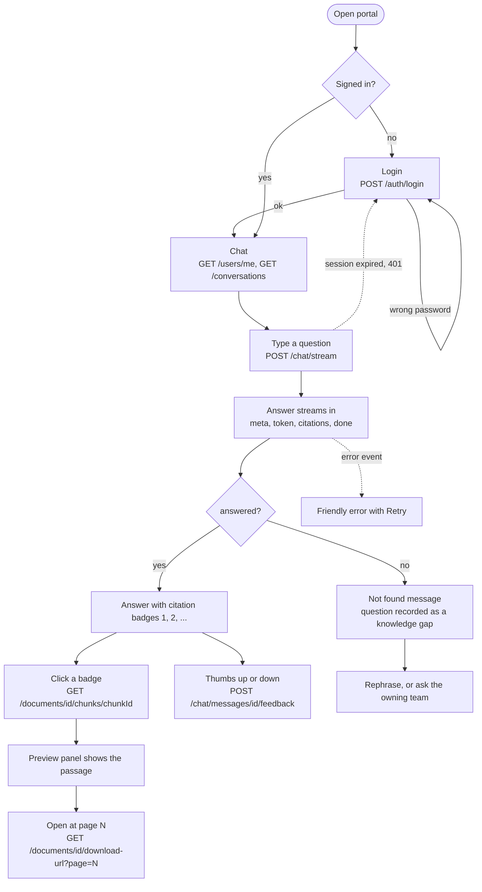
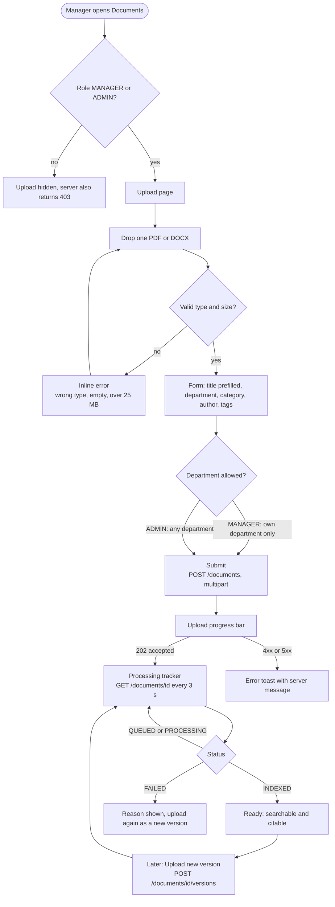
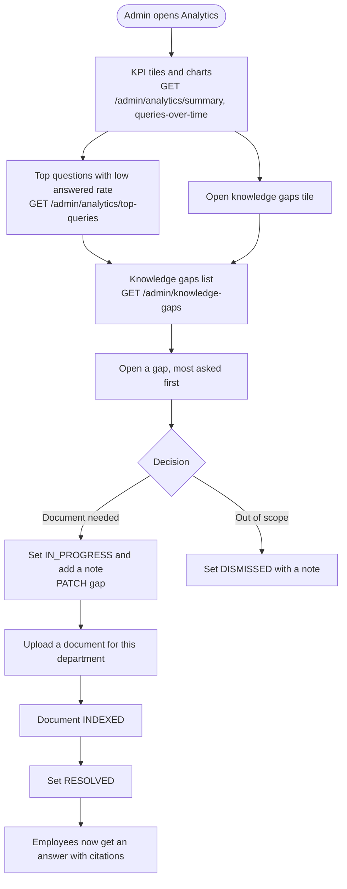

# User workflows

Three flows cover the demo: an **employee** asks a question, a **manager** uploads a document, an **admin** closes knowledge gaps.
Endpoint names come from [`contracts/openapi/core-api.yaml`](../../contracts/openapi/core-api.yaml); the stream format is in [`contracts/streaming.md`](../../contracts/streaming.md).
Screens are in [`ekm-frontend-prototype.html`](ekm-frontend-prototype.html) (library, upload, detail, search) and [`ekm-wireframes-m4-m5.html`](ekm-wireframes-m4-m5.html) (login, chat, analytics, gaps).

## 1. Employee asks a question

## 2. Manager uploads a document

## 3. Admin reviews knowledge gaps

## Who sees what

| Screen | EMPLOYEE | MANAGER | ADMIN |
|---|---|---|---|
| Chat, Search, Documents (own allowed departments) | yes | yes | yes |
| Upload, new version | no | own department | any department |
| Analytics, Knowledge gaps, Audit log, Users | no | no | yes |

The UI hides what a user cannot use, based on `permissions` from `GET /users/me`. The server enforces everything and answers 404 (not 403) for documents in other departments.
