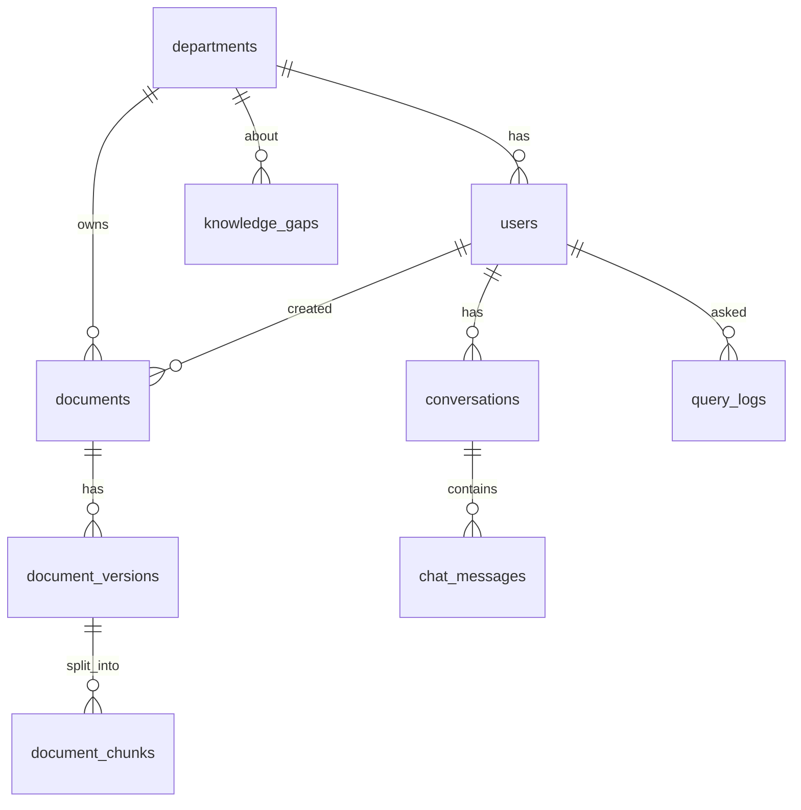

# Database contract (PostgreSQL 16 + pgvector)

- Migrations: [`migrations/`](migrations/) — Flyway naming `V<n>__<description>.sql`. Applied **only** by core-api on startup
  (`spring.flyway.locations=filesystem:/contracts/database/migrations` in Docker, `filesystem:../contracts/database/migrations` locally).
  ai-service and audit-service never run DDL.
- Dev seed (users): [`seed/dev_seed.sql`](seed/dev_seed.sql) — `make seed`. Never runs in staging/prod.
- Merged migrations are immutable. Need a change? Ask Ayushi in `questions/to-ayushi/`, she adds `V<n+1>__...sql`.

## Who writes which table

| Table | Written by | Read by | Notes |
|---|---|---|---|
| `departments` | migration only | all | fixed list |
| `users` | core-api | core-api, audit-service | BCrypt hashes |
| `documents`, `document_versions` | core-api | core-api, ai-service (read-only) | core-api updates status from `ekm-document-status` events |
| `document_chunks` | **ai-service** | ai-service, core-api (citation preview) | core-api may only `UPDATE ... SET is_deleted` on document delete |
| `conversations`, `chat_messages` | core-api | core-api | |
| `audit_logs`, `query_logs`, `knowledge_gaps` | audit-service | core-api (analytics, read-only) | core-api may update `knowledge_gaps.status/notes` via admin API |

## Retrieval query shape (ai-service) — department filter is mandatory
```sql
-- semantic part (cosine similarity = 1 - cosine distance)
SELECT id, document_id, document_title, department_code, version, page_number, section_title, content,
       1 - (embedding <=> :query_embedding) AS semantic_score
FROM document_chunks
WHERE department_code = ANY(:allowed_departments) AND is_current AND NOT is_deleted
ORDER BY embedding <=> :query_embedding
LIMIT :candidate_k;

-- keyword part
SELECT id, ts_rank_cd(content_tsv, websearch_to_tsquery('english', :query)) AS keyword_score
FROM document_chunks
WHERE department_code = ANY(:allowed_departments) AND is_current AND NOT is_deleted
  AND content_tsv @@ websearch_to_tsquery('english', :query)
ORDER BY keyword_score DESC
LIMIT :candidate_k;
-- then fuse: score = w*semantic + (1-w)*normalized_keyword   (or Reciprocal Rank Fusion)
```

## ER overview

