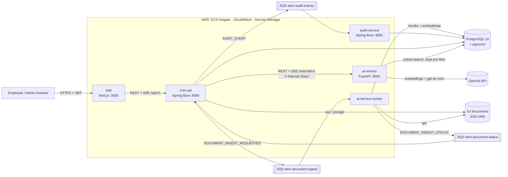

# Architecture

| Concern | Decision |
|---|---|
| Services | `web`, `core-api`, `audit-service`, `ai-service` (API + SQS worker) — see `contracts/ports-and-services.md` |
| Data | One PostgreSQL 16 database with pgvector; table ownership in `contracts/database/README.md` |
| Async | SQS for ingestion (heavy, slow) and audit (fire-and-forget). DLQ after 3 attempts |
| Security | JWT (HS256) issued by core-api; RBAC (EMPLOYEE/MANAGER/ADMIN); department isolation enforced in core-api **and** in the SQL of the retriever; ai-service internal-only |
| AI | text-embedding-3-small (1536-d), gpt-4o-mini; hybrid retrieval (cosine + Postgres FTS); grounded prompt with `[n]` citations; similarity threshold → "not found" → knowledge gap |
| Ops | Docker everywhere; GitHub Actions + Jenkins → ECR → ECS Fargate; CloudWatch logs/metrics/alarms |

See [integration-guide.md](integration-guide.md) for the end-to-end sequences.
