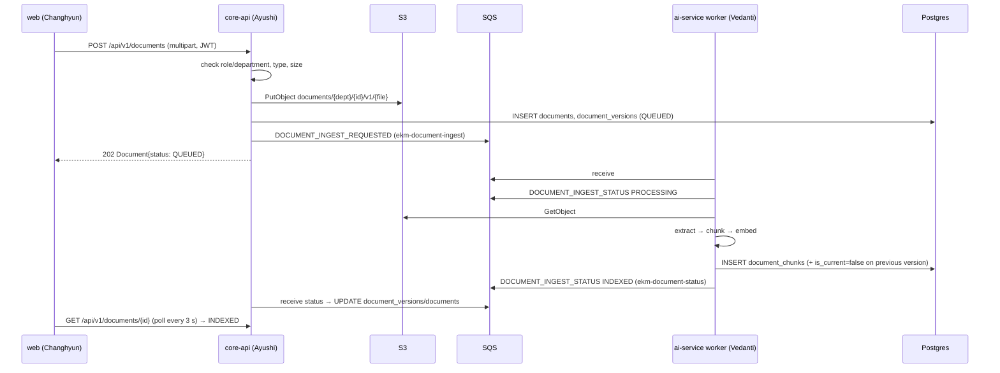
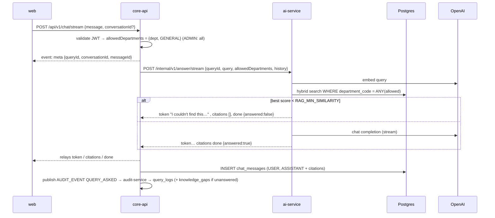

# Integration guide — how the pieces fit (read before integrating)

## Flow 1 — Upload & ingestion

## Flow 2 — Ask a question (streaming)

## Integration checkpoints (put them in the weekly sync)
| Date | Checkpoint | Who |
|---|---|---|
| Oct 21 | Contracts v1 acknowledged by all four; `make up` works on every laptop | all |
| Oct 25 | Upload via UI → S3 → SQS message visible; ai-service consumes the example message and writes chunks (fake embeddings OK) | Changhyun, Ayushi, Vedanti |
| Nov 1 | Status loop closed: document shows INDEXED in UI | Ayushi, Vedanti, Changhyun |
| Nov 8 | `/api/v1/chat` non-streaming answers golden Q001–Q010 with citations | Ayushi, Vedanti |
| Nov 15 | Login + RBAC; zero leakage on RBAC_DENIED golden cases; streaming in UI | all |
| Nov 20 | Staging on ECS reachable; CI/CD green | Manali |
| Nov 28 | Analytics dashboard with real data; eval numbers | Ayushi, Changhyun, Vedanti |
| Dec 1 | Full rehearsal on staging | all |

## Debugging across services
- Every request/message carries `X-Request-Id` / `traceId`. Grep it in all logs: `make logs | grep <traceId>`.
- Check queues: `aws --endpoint-url http://localhost:4566 sqs get-queue-attributes --queue-url http://localhost:4566/000000000000/ekm-document-ingest-dlq --attribute-names ApproximateNumberOfMessages`
- Something doesn't match the contract? Don't patch around it silently — open a question to the owner.
