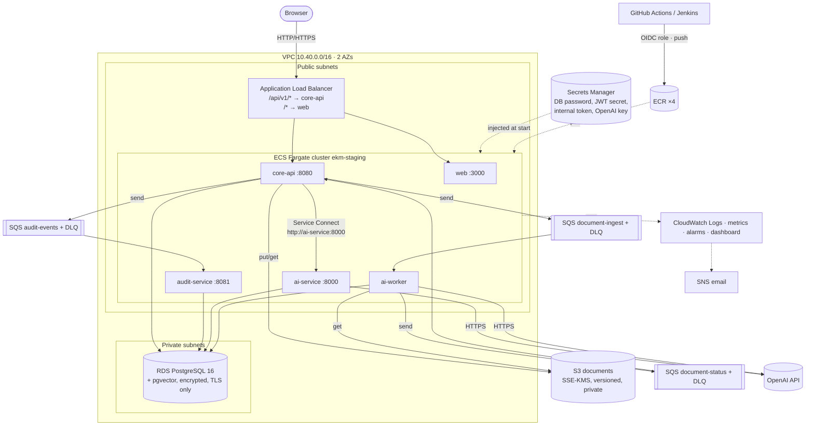

# AWS architecture (staging)

| Component | Terraform file | Notes |
|---|---|---|
| VPC, subnets, IGW, optional NAT, S3 gateway endpoint | `network.tf` | Default: no NAT (saves ~$32/mo); tasks get public IPs but SGs allow ingress only from the ALB / each other |
| Security groups | `security_groups.tf` | ALB ← internet :80/:443 · tasks ← ALB + tasks · RDS ← tasks :5432 |
| ECR (web, core-api, audit-service, ai-service) | `ecr.tf` | Immutable tags (= git SHA), scan on push, keep 20 |
| S3 documents bucket + KMS key | `s3.tf` | SSE-KMS, versioning, block public access, TLS-only policy, CORS for presigned GETs |
| SQS ×3 + DLQ ×3 | `sqs.tf` | Long polling, SSE, maxReceiveCount 3, ingest visibility 300 s |
| RDS PostgreSQL 16 | `rds.tf` | db.t4g.micro, private, encrypted, `rds.force_ssl=1`, 7-day backups; pgvector created by Flyway V1 |
| Secrets | `secrets.tf` | Generated DB password / JWT secret / internal token; OpenAI key set by hand. Each container only gets the secrets it needs |
| IAM | `iam.tf` | One execution role; one least-privilege task role per service (+ ECS Exec) |
| ECS cluster, task definitions, services, autoscaling, Service Connect | `ecs.tf` | Rolling deploys with circuit breaker + automatic rollback; CPU target tracking 60% |
| ALB, target groups, listeners | `alb.tf` | 120 s idle timeout for SSE; HTTPS + redirect when `certificate_arn` is set |
| CloudWatch alarms, log metric filters, dashboard, SNS, AWS Budget | `monitoring.tf` | See [operations-runbook.md](operations-runbook.md) |
| GitHub OIDC deploy role | `github_oidc.tf` | Only `main` / environment `staging` can assume it; ECR push + ECS deploy only |

## Security summary (for the report)
- No long-lived AWS keys anywhere: GitHub uses OIDC, ECS tasks use IAM task roles.
- Data encrypted at rest (S3 SSE-KMS with rotation, RDS storage encryption, SQS SSE, Secrets Manager) and in transit (TLS-only S3 policy, RDS force_ssl, HTTPS on the ALB when a certificate is configured).
- Network isolation: RDS in private subnets; ai-service / audit-service / ai-worker not reachable from the internet; only `/api/v1/*` and the web app are exposed.
- Least privilege: per-service task roles (e.g. web has no AWS permissions; audit-service can only consume the audit queue); per-service secret injection.
- Images: non-root users, pinned base images, ECR scan on push, Trivy report in CI.

## Cost estimate (us-west-2, on-demand, running 24/7)
| Item | ≈ USD / month |
|---|---|
| Fargate: 2 vCPU + 4.5 GB total across 5 tasks (x86) | 74 |
| Public IPv4 addresses (5 tasks + ALB) | 26 |
| Application Load Balancer | 18 |
| RDS db.t4g.micro + 20 GB gp3 | 15 |
| CloudWatch (logs, ~25 alarms, dashboard) | 8 |
| Secrets Manager, KMS, SQS, S3, ECR | 4 |
| **Total** | **≈ 145** (+ OpenAI usage) |

Use `make aws-sleep` when nobody is testing (ECS → 0 tasks, RDS stopped) — idle cost drops to ≈ $25/month (ALB, storage).
Use AWS academic credits; the Budget alarm emails at 80% of `monthly_budget_usd`.
