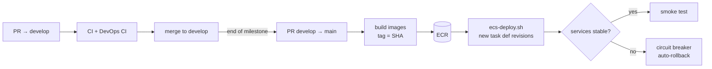

# CI/CD

| Workflow | Trigger | What it does |
|---|---|---|
| `.github/workflows/ci.yml` | every PR / push to `develop`, `main` | Contracts lint + event schema validation; build/test each service **once it exists** (backend Maven, frontend pnpm + generated-types drift check, ai pytest with `AI_PROVIDER=fake`) |
| `.github/workflows/devops-ci.yml` | PRs touching infra files | hadolint, shellcheck, actionlint, `docker compose config`; pytest config tests; Terraform fmt/validate/**test**/tflint/checkov; build + run every Dockerfile template (fixtures and real services) + Trivy report; integration tests against Postgres+pgvector and LocalStack |
| `.github/workflows/cd-staging.yml` | push to `main`, manual | Build images for services that exist → push to ECR (tag = commit SHA) → new task definition revisions → `services-stable` → smoke test. Without `AWS_DEPLOY_ROLE_ARN` it only builds |
| `manali_devops/jenkins/Jenkinsfile` | Jenkins job | Same stages as GitHub Actions; deploys when `DEPLOY=true` on `main` |



## Shared scripts (used by Actions, Jenkins and `make`)
- `manali_devops/scripts/build-push.sh <env> <tag>`: builds every existing service from the Dockerfile templates; prints `PUSHED: ...`
- `manali_devops/scripts/ecs-deploy.sh <env> <tag> [services]`: clones the latest task definition of each family with the new image, registers it, updates the service, waits until stable. `DRY_RUN=1` prints only.
- `manali_devops/scripts/staging-power.sh up|down`: wakes or pauses staging.

Because the CD clones the **latest** task definition revision, env/secret changes made by Terraform are picked up by the next deploy (Terraform ignores `task_definition` on the service so it never reverts a CD deploy).

## GitHub settings checklist
- [ ] Branch protection on `main` and `develop`: PR required, 1 approval, status checks `Contracts`, `Lint`, `Config tests`, `Terraform`
- [ ] Repository variables `AWS_DEPLOY_ROLE_ARN`, `AWS_REGION`, `STAGING_URL` ([aws-deployment.md](aws-deployment.md) §5)
- [ ] Environment `staging` (optional required reviewer)

## Running Jenkins locally (for the course requirement)
```bash
docker run -d --name jenkins -p 8090:8080 -v jenkins_home:/var/jenkins_home \
  -v /var/run/docker.sock:/var/run/docker.sock jenkins/jenkins:lts-jdk21
docker exec jenkins cat /var/jenkins_home/secrets/initialAdminPassword
```
Install the suggested plugins + *Pipeline*, *Docker Pipeline*, *JUnit*. Create a Pipeline job → *Pipeline script from SCM* →
this repo, branch `main`, Script Path `manali_devops/jenkins/Jenkinsfile`. The agent needs docker CLI, aws CLI, jq, python3, node 20.
For deploys give Jenkins AWS credentials with the same permissions as the GitHub deploy role (never an admin key).
